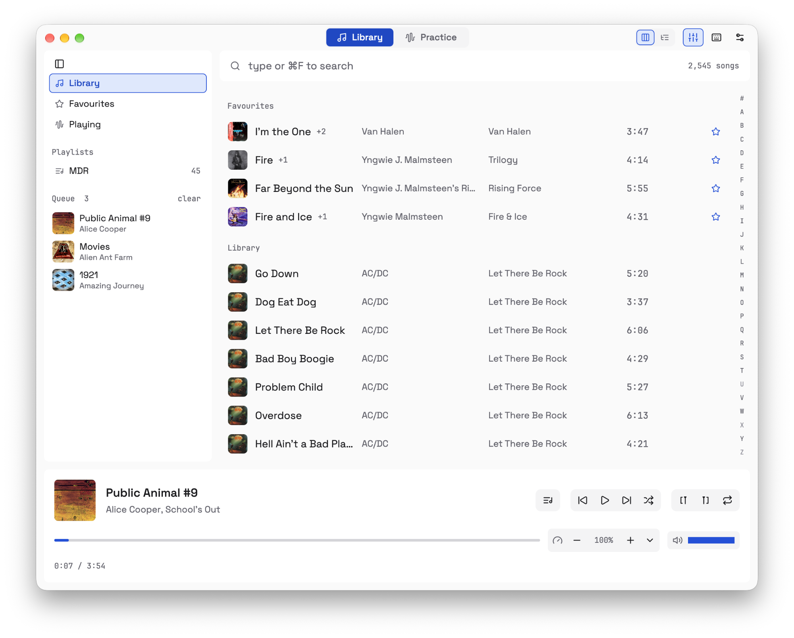
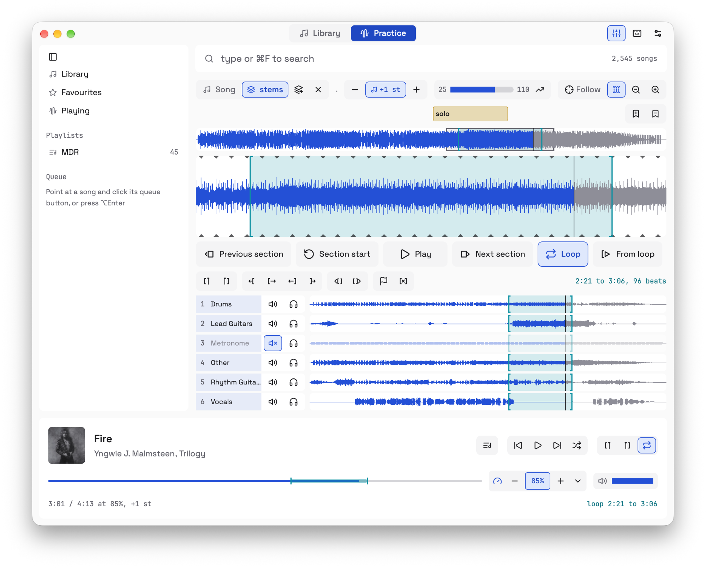

# Odeion

A music player and a practice tool in one, for macOS. Listen to your own library, or
loop the solo, slow it down, mute the guitar and play along.

Named after the odeion, the small concert hall of ancient Greece, where people came to
hear music and musicians came to play it.



## What it does

**Listen**

- Your own music folder, opened instantly, even with thousands of songs.
- Search as you type, albums, artists, favourites, a queue and playlists.

**Practise**

- Drag across the waveform to loop a part, gapless.
- Slow down or change key without the other changing, plus a speed trainer.
- Drop in stems ([Moises](https://moises.ai) or any splitter) or a backing track; Odeion
  lines them up. Mute or solo with one key.
- Beats found from the recording, so loops snap to them even on records that drift.
- Name sections and drop a marker. Every song comes back as you left it.



**Everywhere**

- Keyboard first (Mac or Vim keys), every key also a button. `⌘?` lists them all.
- Right-click menus, a 10-band EQ, media keys, light and dark.
- Two colour schemes: T3 (cool greys, clear blue) and Gold (warm paper, gold).
- Plays mp3, flac, wav, aiff, m4a (AAC and ALAC) and ogg.

## Getting started

Download the latest `Odeion-<version>.zip` from
[Releases](https://github.com/timvancann/odeion/releases), unzip it and drag Odeion into
Applications. It runs on macOS 13 or later, Apple silicon and Intel. If macOS says it
can't check the app, open it once, then click Open Anyway in System Settings, Privacy &
Security.

Or build it yourself, with [Rust](https://rustup.rs),
[just](https://github.com/casey/just) and
[resvg](https://github.com/linebender/resvg) (for the app icon):

```sh
just run       # run from source
just install   # build Odeion.app into ~/Applications
```

On first start Odeion asks for the folder your music is in. Add more in settings (`⌘,`).

Your music stays where it is: Odeion never writes next to your songs. Its cache, loops,
sections, playlists and settings live in `~/Library/Application Support/odeion/`, or in
another folder you choose in settings.

## Inspiration

Odeion started as a way to find songs for [Transcribe!](https://www.seventhstring.com),
the tool I learned songs with for years, because finding a file in it is painful. It
grew until it did everything I used Transcribe! for: loops, the waveform, slowing down,
sections and markers. What it adds is the other recordings of a song in one place, an
idea from [Moises](https://moises.ai), where backing tracks and stems sit next to the
original.

The player side looks back to Winamp, with its queue, playlists and the 10-band EQ.
The look and the keyboard come from [Zed](https://zed.dev), and the collapsing sidebar
from VS Code.

## Acknowledgements

Odeion stands on these projects:

- [GPUI](https://www.gpui.rs), Zed's UI framework, through
  [gpui-pre](https://crates.io/crates/gpui-pre), its maintained snapshot on crates.io.
- [rodio](https://github.com/RustAudio/rodio) and
  [cpal](https://github.com/RustAudio/cpal) for playback,
  [Symphonia](https://github.com/pdeljanov/Symphonia) for decoding.
- [Signalsmith Stretch](https://signalsmith-audio.co.uk/code/stretch/) for changing
  speed and pitch.
- [Lofty](https://github.com/Serial-ATA/lofty-rs) for tags and covers.
- [RustFFT](https://github.com/ejmahler/RustFFT) for the spectra behind beat finding.
- [souvlaki](https://github.com/Sinono3/souvlaki) for media keys and Now Playing.
- Beat finding follows Böck and Widmer's SuperFlux onset detector and Dan Ellis's
  dynamic-programming beat tracker.
- The EQ's filters use Robert Bristow-Johnson's Audio EQ Cookbook.
- The default T3 colour scheme takes its greys and blue from
  [T3 Code](https://github.com/pingdotgg/t3code), whose clean look it follows.
- Icons from [Lucide](https://lucide.dev), fonts
  [JetBrains Mono](https://www.jetbrains.com/lp/mono/) and
  [Space Grotesk](https://fonts.google.com/specimen/Space+Grotesk).

## Roadmap

- **Tags and covers from MusicBrainz.** Look up a song or album with missing tags or no
  cover on [MusicBrainz](https://musicbrainz.org) and the Cover Art Archive, check the
  match, and fill them in. Only when you ask, since it writes into your files.
- **Stems from Moises, in Odeion.** Split a song into stems through the
  [Moises API](https://music.ai) with
  your own key, and get them back lined up on the song, ready to mute and solo.

## Licence

[PolyForm Noncommercial 1.0.0](LICENSE): free to use, change and share for any
noncommercial purpose (personal use, study, teaching, hobby projects, charities). Selling
Odeion or using it in a commercial product needs the author's permission. The bundled
fonts and icons keep their own licences, beside them in `assets/`.
